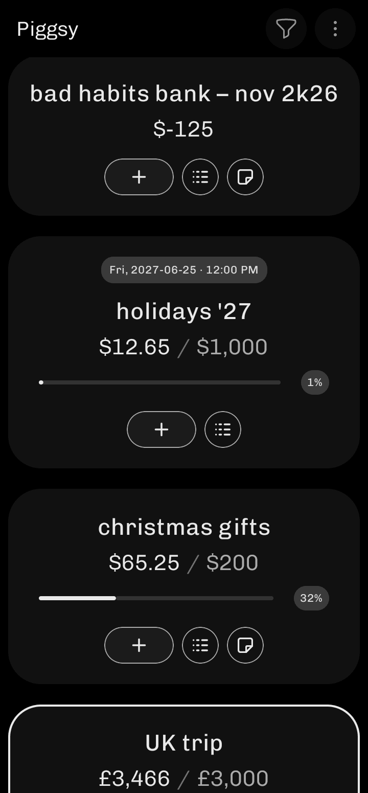
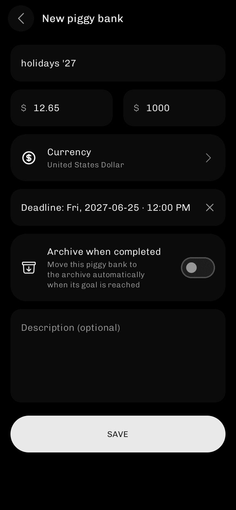
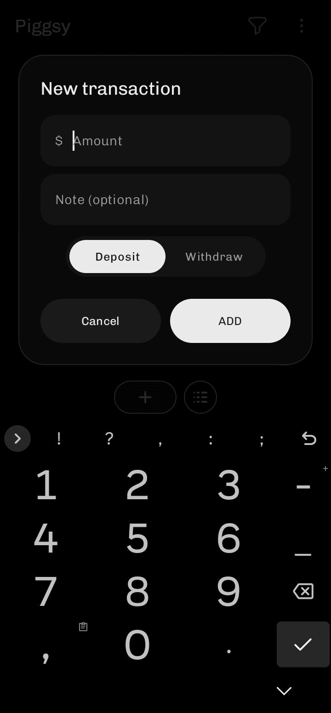
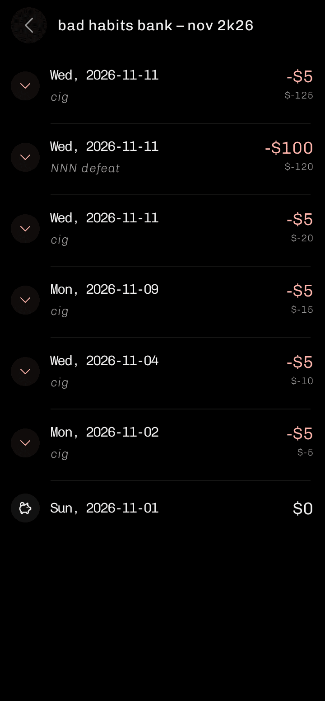
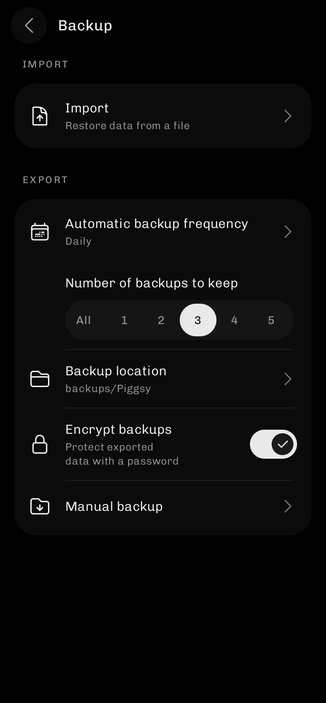
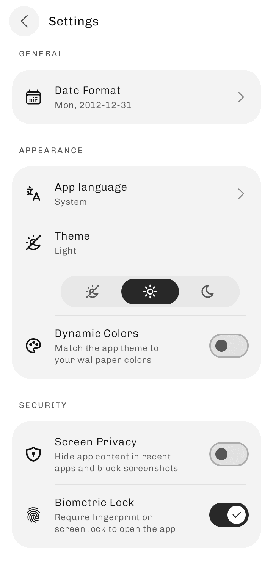
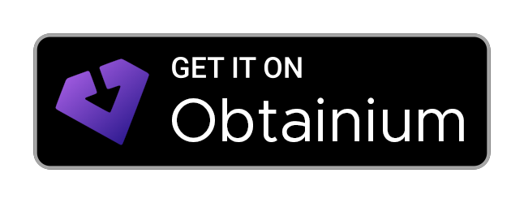

  

Piggsy is a simple way to keep track of your savings, all in one place.

Whether you're saving for a trip, a new gadget, or building an emergency fund, this app offers you a space for multiple piggy banks in your preferred currency. Flexible deadlines and notes will help you stay organized. You're in control of everything.

## Features

- **Multiple piggy banks**
  Create as many goals as you need. Each has its own optional target, currency, optional deadline, and notes.

- **Track deposits and withdrawals**
  Add or withdraw money whenever you need to keep your balance up to date. Each piggy bank is your premise and keeps a full transaction history with notes for individual transactions.

- **Deadlines**
  Pick a specific day and time in the calendar and get notified when the deadline is reached.

- **Automatic encrypted backups**
  Pick a folder and let Piggsy export data in the background, so your savings goals and transaction history don't get lost.

- **Private by design**
  Biometric lock, no analytics and no INTERNET permission. Your data stays on your device.

## Screenshots

  
  
  

  
  
  

## Download

  
  
  
SHA-256: <code>9242b92c7df80e474b091d6083b273be4912b4aca87e53dae7ffc8530413876e</code>

## Dependencies

- [Chivo](https://fonts.google.com/specimen/Chivo) – SIL OFL
- [heroicons](https://github.com/tailwindlabs/heroicons) – MIT
- [Tabler Icons](https://github.com/tabler/tabler-icons) — MIT

## Credits

Piggsy is a fork of [Centsation](https://github.com/mowtiie/centsation) by [mowtiie](https://github.com/mowtiie).
